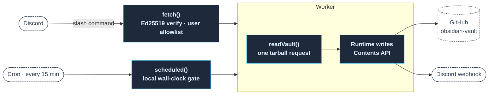
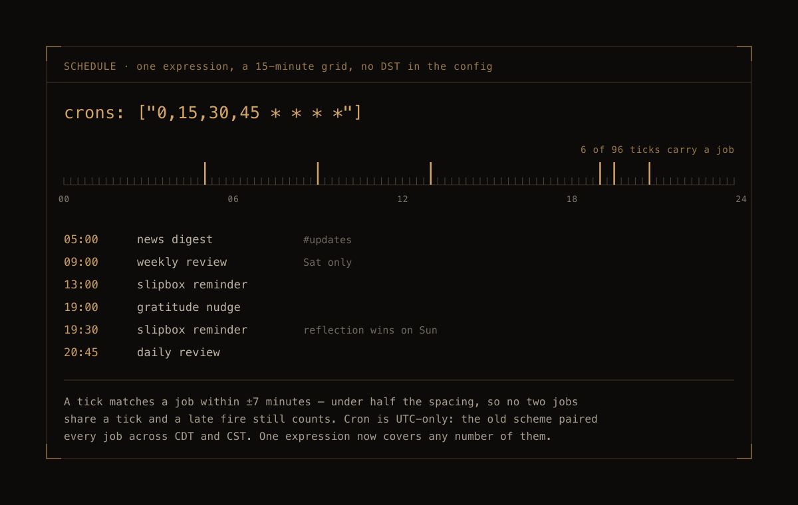

# slipbox-agent

*A cloud-resident agent that keeps a Zettelkasten on schedule — and never writes in it.*

A single Cloudflare Worker sits beside an Obsidian vault stored in a GitHub repo. It captures stray thoughts from Discord, reads the vault back to you on a schedule, files journal entries, and prunes what has gone stale. The one thing it will not do is write a note for you.

That constraint is the design. A slipbox is only worth keeping if the notes in it are yours; an agent that drafts them produces a pile that looks like thinking and isn't. So there is no model in the loop at all: everything it files is your own words, copied verbatim, and the runtime performs every file operation.

---

## The two halves



`fetch` is the Discord Interactions endpoint. `scheduled` is the cron half. They share the vault reader and the write path; nothing else.

---

## Capture — the inbound commands

| Command | Effect |
| :--- | :--- |
| `/zettel <text>` | Appends a line, stamped `[HH:MM]` local time, to today's `Inbox/` file, creating it if needed |
| `/gratitude` · `/long-dream` · `/near-dream` · `/relationships` · `/values` | One command per question, answered in any order: what you're grateful for, one "unrealistic" long-term dream and one closer-term dream you're concretely chasing, how you're cultivating genuine relationships, and how you lived your values today (and if not, how you'll improve tomorrow). Each answer is saved to a draft (`Systems/gratitude-draft.json`); after the fifth, the entry is written to `Journal/Cogitations.md` — no agent reply |
| `/reflect learned:<…> mistake:<…> value:<…>` | All three required, recorded verbatim to `Journal/Cogitations.md` under a `## <date> — Weekly Reflection` heading, so it sits beside that day's gratitude entry without being mistaken for it — no agent reply |

Every command is verified before it is read: Discord signs each request with Ed25519 and deliberately sends invalid signatures to check that the endpoint rejects them — one that doesn't gets disabled. After the signature, the caller's user id is checked against a single allowlisted id. Anyone else gets *"Not your slipbox."*

Each command needs at least two GitHub round-trips, which does not fit Discord's three-second reply deadline. So the handler acknowledges immediately with a deferred response and edits the placeholder when the work lands.

---

## Schedule — one cron expression



Cloudflare cron is UTC-only. Holding a fixed *local* time across daylight saving used to mean registering every job twice — once at its CDT hour, once at its CST hour — with the handler discarding the wrong half. That cost one expression per job against a free-plan cap of five.

The schedule is now a single expression ticking every fifteen minutes. The handler converts to local time and matches minutes-of-day within ±7 minutes — a tolerance that must stay under half the tick spacing, so that a trigger firing a minute late still counts while two jobs on adjacent ticks can never both match and let the `if`/`else` silently drop the second.

| Local | Job |
| :--- | :--- |
| 00:00 Sat | Zettel roll-up — every live `Inbox/` file dated before today, verbatim, prepended to `Journal/Zettels Review.md`, then moved to `Inbox/archive/` (no model call), then a notice to `#learning` |
| 05:30 | Value reminder — the `Value goal` from the latest weekly reflection, verbatim, to `#learning`. One GitHub read, no model call; silent if the latest reflection has none |
| 19:00 | Gratitude nudge |
| 19:30 Sun | Weekly reflection nudge |

Almost all of the ninety-six daily ticks match nothing and return immediately.

---

## No commentary on the journals

The journals are record-only. `/gratitude` and `/reflect` entries are written verbatim, and the weekly review is the zettel roll-up: the week's inbox, copied into `Journal/Zettels Review.md` as-is, then archived. No model reads or comments on any of them, and the Worker makes no model calls at all.

---

## Notes from the build

**The whole vault arrives in one request.** Rather than walking the tree over the Contents API, `readVault` pulls the repo tarball, gunzips it with `DecompressionStream`, and untars it in memory. One request instead of hundreds.

**Writes are ordered so a Discord failure is never a data loss.** The journal entry commits before the reply is sent. A webhook that fails costs the notification, never the entry.

---

## Configuration

Non-secret settings live in `wrangler.jsonc` `vars` — the repo and branch, the timezone, and the local hour and minute of each job.

Secrets are set with `wrangler secret put <NAME>` and never appear in the repo:

| Secret | Purpose |
| :--- | :--- |
| `GITHUB_TOKEN` | Fine-grained PAT, Contents: Read and write |
| `DISCORD_WEBHOOK_LEARNING` | `#learning` — zettel roll-up notice and both journal nudges |
| `DISCORD_PUBLIC_KEY` | The app's Ed25519 public key, verifies interactions |
| `DISCORD_USER_ID` | The only id whose commands are accepted |

---

## Running it

```bash
npm install
npm run dev        # local Worker
npm run deploy     # publish
npm run tail       # live logs

./register.sh      # register slash commands (prompts for the bot token)
```

`register.sh` registers commands with `PUT`, which replaces the whole set — so a renamed command removes the old name instead of leaving both.

There are no model calls, so running cost is just the Worker and the GitHub API.

---

## License

MIT.
