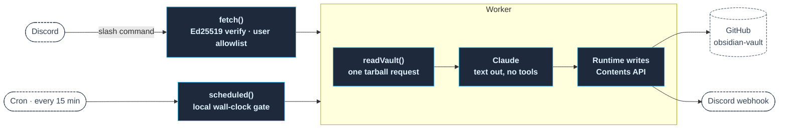
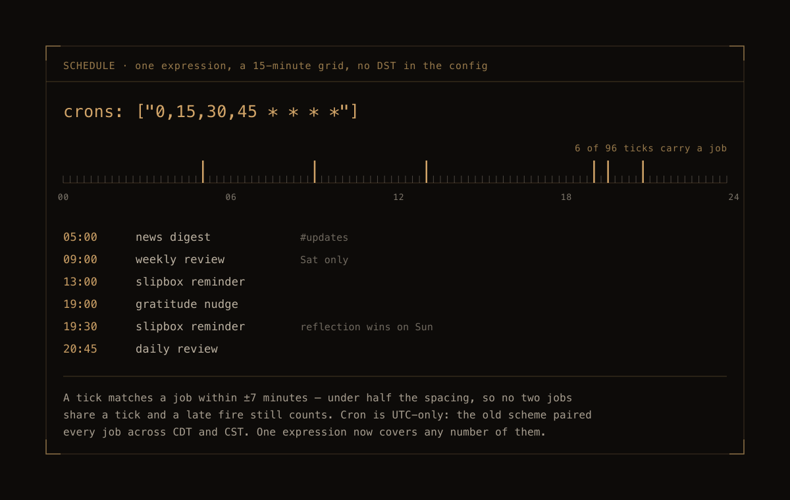

# slipbox-agent

*A cloud-resident agent that keeps a Zettelkasten on schedule — and never writes in it.*

A single Cloudflare Worker sits beside an Obsidian vault stored in a GitHub repo. It captures stray thoughts from Discord, reads the vault back to you on a schedule, files journal entries, and prunes what has gone stale. The one thing it will not do is write a note for you.

That constraint is the design. A slipbox is only worth keeping if the notes in it are yours; an agent that drafts them produces a pile that looks like thinking and isn't. So the model is given no write capability at all — it returns text, and the runtime performs every file operation.

---

## The two halves



`fetch` is the Discord Interactions endpoint. `scheduled` is the cron half. They share the vault reader, the model call, and the write path; nothing else.

---

## Capture — the inbound commands

| Command | Effect |
| :--- | :--- |
| `/zettel <text>` | Appends a line to today's `Inbox/` file, creating it if needed |
| `/gratitude <text>` | Records the entry in the journal, then replies in Arete's voice |
| `/reflect learned:<…> mistake:<…>` | Both halves required — the reflection reads one against the other |

Every command is verified before it is read: Discord signs each request with Ed25519 and deliberately sends invalid signatures to check that the endpoint rejects them — one that doesn't gets disabled. After the signature, the caller's user id is checked against a single allowlisted id. Anyone else gets *"Not your slipbox."*

Each command needs at least two GitHub round-trips, which does not fit Discord's three-second reply deadline. So the handler acknowledges immediately with a deferred response and edits the placeholder when the work lands.

---

## Schedule — six jobs, one cron expression



Cloudflare cron is UTC-only. Holding a fixed *local* time across daylight saving used to mean registering every job twice — once at its CDT hour, once at its CST hour — with the handler discarding the wrong half. That costs one expression per job against a free-plan cap of five, and the sixth job would not have fit.

The schedule is now a single expression ticking every fifteen minutes. The handler converts to local time and matches minutes-of-day within ±7 minutes — a tolerance that must stay under half the tick spacing, so that a trigger firing a minute late still counts while two jobs on adjacent ticks can never both match and let the `if`/`else` silently drop the second.

| Local | Job |
| :--- | :--- |
| 05:00 | News digest → `#updates` |
| 09:00 Sat | Weekly review — folds the week's dailies, prunes the inbox |
| 13:00 | Slipbox reminder |
| 19:00 | Gratitude nudge |
| 19:30 | Slipbox reminder — the Sunday reflection nudge takes this slot instead |
| 20:45 | Daily review |

Ninety of the ninety-six daily ticks match nothing and return immediately.

---

## Review — what the agent actually produces

The daily entry names what recurred and how often with dates, one structural observation about the day's thinking you didn't make yourself, and exactly one question. The weekly goes wider: a four-week recurrence table, and any theme circled three times with no note written yet, stated flatly as *write it or drop it*.

Both are prepended to `Journal/Review.md`. The weekly pass then folds the week's daily entries into itself and drops them, which is what stops `Review.md` from becoming a second pile, and archives inbox files older than seven days into `Inbox/archive/`.

**Prompts are data, not deployment.** The instructions for each job live in the vault (`Systems/prompts/*.md`), not in the Worker. Rewriting how the review reads is a commit to the vault, not a redeploy.

---

## Notes from the build

**The whole vault arrives in one request.** Rather than walking the tree over the Contents API, `readVault` pulls the repo tarball, gunzips it with `DecompressionStream`, and untars it in memory. One request instead of hundreds.

**Reference notes are truncated before the prompt is built.** `Knowledge/` is a reference library, not thinking material. Four files there are roughly 45% of the vault by bytes and would dominate every prompt for nothing, so anything under that prefix is cut to 200 words. Everything the agent actually reasons over — `Inbox/`, `Slipbox/`, `Journal/`, `Systems/` — ships in full.

**Models are chosen per job.** Daily reviews run Sonnet 5 at high effort, weekly reviews Opus 5 at xhigh, journal reflections Opus 5 at high. The news digest uses Opus 5 with the server-side `web_search` tool, which pauses the turn after ten tool iterations; the handler resumes by re-sending with the partial assistant turn appended, bounded to three resumes.

**Writes are ordered so a Discord failure is never a data loss.** The journal entry commits before the reply is sent. A webhook that fails costs the notification, never the entry.

**The nudge with no command to answer it.** The slipbox reminder deliberately routes nowhere. `/zettel` captures to `Inbox/`, and the names invite exactly the wrong reflex — answering a *write a note* reminder with a capture, which is the substitution the whole design exists to prevent. So the reminder says so out loud and points at Obsidian.

---

## Configuration

Non-secret settings live in `wrangler.jsonc` `vars` — the repo and branch, the timezone, and the local hour and minute of each job.

Secrets are set with `wrangler secret put <NAME>` and never appear in the repo:

| Secret | Purpose |
| :--- | :--- |
| `ANTHROPIC_API_KEY` | Model calls |
| `GITHUB_TOKEN` | Fine-grained PAT, Contents: Read and write |
| `DISCORD_WEBHOOK_LEARNING` | `#learning` — reviews and both journal nudges |
| `DISCORD_WEBHOOK_UPDATES` | `#updates` — the morning news digest |
| `DISCORD_PUBLIC_KEY` | The app's Ed25519 public key, verifies interactions |
| `DISCORD_USER_ID` | The only id whose commands are accepted |

---

## Running it

```bash
npm install
npm run dev        # local Worker
npm run deploy     # publish
npm run tail       # live logs

./register.sh      # register slash commands (prompts for the bot token)
```

`register.sh` registers commands with `PUT`, which replaces the whole set — so a renamed command removes the old name instead of leaving both.

Roughly $3–5/month at current vault size, almost all of it model calls.

---

## License

MIT.
